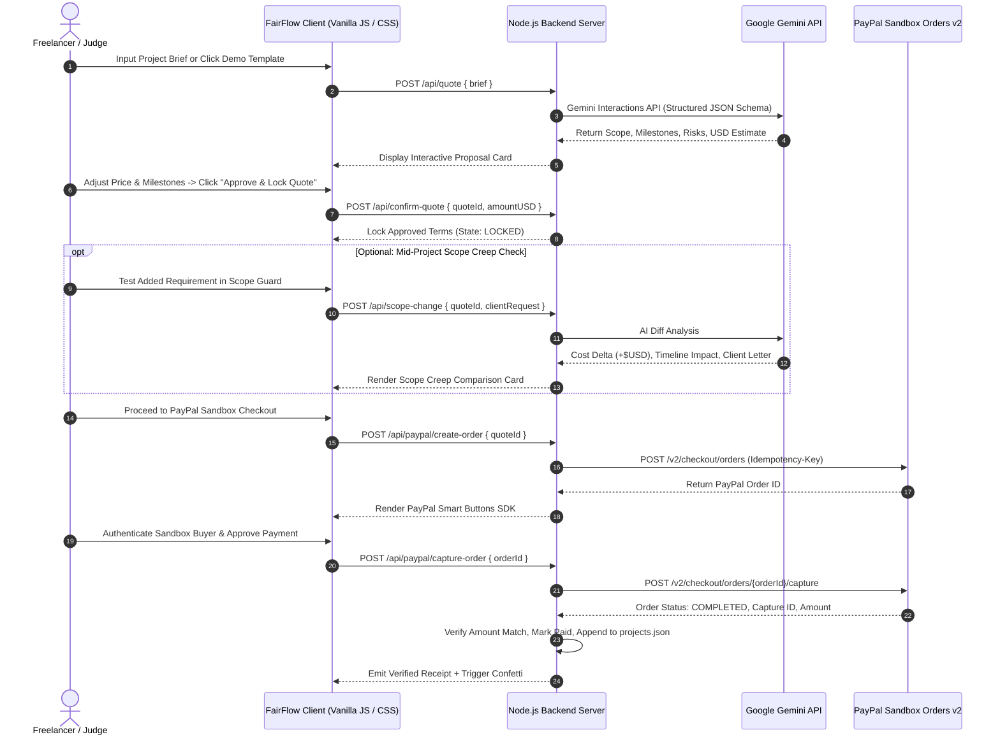

# FairFlow AI — AI-Powered Freelancer Trust & Payment OS

[](https://paypalaihackathon.devpost.com/)
[](https://nodejs.org/)
[](https://aistudio.google.com/)
[](https://developer.paypal.com/docs/api/orders/v2/)
[](LICENSE)
[](#architecture)

> **"From Project Agreement to Secure Payments, Powered by AI."**  
> FairFlow AI bridges the critical trust gap between freelancers and clients. By combining Google Gemini's cognitive analysis with PayPal's global payments infrastructure, FairFlow turns conversational project briefs into structured agreements, guards against scope creep, and uses PayPal Sandbox to capture one full approved quote amount; milestones remain planning percentages.

---

**Reviewing for the PayPal AI Hackathon?** Run `npm run demo:offline` for a credential-free, clearly labelled **SIMULATED** end-to-end walkthrough (no real Gemini or PayPal requests). The actual external APIs work in separate real-provider mode. Start with the [Judges Quick Start](JUDGES_START_HERE.md) for safe localhost setup, the real AI workflow, the difference between mocked and real Sandbox verification, and the important no-escrow boundaries.

**Design system:** [DESIGN.md](DESIGN.md) documents brand tokens, dashboard interaction rules, motion constraints, accessibility targets, and release gates.

**Final quality release:** [Performance, accessibility and error-recovery gate](FINAL_QUALITY_GATE.md) documents the test evidence, measured limitations and safe no-payment verification steps.

## Table of Contents

1. [The Problem & The Solution](#the-problem--the-solution)
2. [Key Innovations & Features](#key-innovations--features)
3. [Architecture & System Flow](#architecture--system-flow)
4. [Live Demo Walkthrough for Judges](#live-demo-walkthrough-for-judges)
5. [Quick Start & Setup Instructions](#quick-start--setup-instructions)
6. [PayPal Sandbox Testing Credentials](#paypal-sandbox-testing-credentials)
7. [API Reference](#api-reference)
8. [Security & Sandbox Safeguards](#security--sandbox-safeguards)
9. [Automated Tests & Verification](#automated-tests--verification)
10. [Hackathon Submission Information](#hackathon-submission-information)
11. [License](#license)

---

## The Problem & The Solution

| The Freelancer Nightmare | The FairFlow AI Solution |
| :--- | :--- |
| **Vague Scope & Disagreements:** Scope changes and unbilled revisions can lead to pricing disagreements and lost income. | **Gemini Scoping Engine:** AI structures informal briefs into itemized deliverables, milestone timelines, assumptions, and proactive risk audits. |
| **Silent Scope Creep:** Clients add "just one small feature" mid-project, leading to unpaid labor and resentment. | **AI Scope-Change Detector:** Real-time diff analysis comparing new requests against baseline scope, estimating the potential additional cost (+$USD) and schedule impact for human review. |
| **Payment Friction & Insecurity:** Sending raw invoices with no milestone protection leaves both parties exposed. | **PayPal Sandbox Orders v2:** Server-side order creation and capture with sandbox checkout, server-side payment verification, and printable test receipts. |
| **Lack of Human Agency:** Fully automated AI pricing can hallucinate unrealistic budgets. | **Human-in-the-Loop Approval:** The freelancer retains absolute authority. AI advises; humans approve; PayPal Sandbox processes test payments. |

---

## Key Innovations & Features

### 1. Multi-Model Gemini Scoping Engine
* Analyzes messy client messages or brief descriptions into structured scopes.
* Generates itemized deliverables, percentage-based milestone breakdowns (Deposit, Alpha, Final Review), risk watchouts, and clarification questions.
* **Resilient Cascade Architecture:** Tries the configured Gemini model, then configured fallback models. The owner verified successful real generation with `gemini-3.1-flash-lite` on November 10, 2026.

### 2. 1-Click AI Prompt Enhancer
* Turns 5-word ideas (e.g. *"build an online coffee store"*) into comprehensive technical briefs specifying tech stack, authentication, database schema, payment gateways, and security requirements.

### 3. Human-in-the-Loop Financial Control
* Freelancers can manually tweak milestone percentages and hit **"Auto-Balance to 100%"** for mathematically sound payment schedules.
* Hard validation bounds ($1.00 – $10,000.00 USD) prevent accidental under- or over-charging.

### 4. AI Scope-Change Detector (Scope Creep Guard)
* Pinpoints differences between the human-approved baseline and new mid-project requests.
* Suggests an **estimated** financial delta (e.g. *+$1,200 USD*) and possible delivery time change, both subject to human approval.
* Produces a copyable DRAFT change-order summary with the original price, requested additions and estimated financial/timeline impact. Copying it never changes price or charges the buyer.

### 5. Server-Verified PayPal Sandbox Orders API v2 Integration
* Server-side order initialization (`POST /v2/checkout/orders`) with unique idempotency keys.
* Client-side PayPal Smart Buttons loaded dynamically with sandbox client configuration.
* Server-side capture verification (`POST /v2/checkout/orders/{id}/capture`): verifies `COMPLETED` order status, matching capture ID, exact dollar amounts, and prevents replay or double-capture attacks.

### 6. Apple-Inspired Fluid Interface
* Distinctive editorial layout with warm off-white surfaces, charcoal typography, cobalt actions, and an interactive scope comparison.
* Serif display typography, responsive layouts, keyboard-visible focus rings, reduced-motion handling, and lightweight animations.
* Lightweight inline SVGs for key controls, with labelled sample scenarios in the demo.

### 7. Zero External NPM Dependencies
* Built entirely on Node.js 22+ native modules: `http`, `crypto`, and native `fetch`.
* Lightweight runtime with no third-party npm packages; this does not eliminate security risks or replace production hardening.

---

## Architecture & System Flow



---

## Live Demo Walkthrough for Judges

Judges can test the entire lifecycle in under **2 minutes** at `http://localhost:3000`:

```
┌────────────────────────────────────────────────────────────────────────┐
│                        3-STEP JUDGE DEMO FLOW                          │
│                                                                        │
│   [ Step 1: Create & Scope ]   ───►  [ Step 2: Guard Against Creep ]   │
│   • Click 1-Click Demo Chip          • Click "Add Multi-Vendor Payouts"│
│   • Watch Gemini AI Scoping          • See AI calculate +$USD delta    │
│   • Auto-Balance to 100%             • Review professional letter      │
│   • Click "Approve & Lock Quote"                                       │
│                                              │                         │
│                                              ▼                         │
│                                [ Step 3: PayPal Sandbox Checkout ]      │
│                                • Launch PayPal Sandbox Smart Button    │
│                                • Complete Sandbox payment              │
│                                • View server-verified receipt & history│
└────────────────────────────────────────────────────────────────────────┘
```

### Detailed Scenario Guide

1. **Dashboard & Analytics:**
   * Open `http://localhost:3000`.
   * Observe high-level metrics (Total Volume, Active Agreements, Paid Projects, Sandbox Capture History) and the live transaction feed.
2. **Generate AI Proposal:**
   * Click **"+ New Proposal"**.
   * Click any 1-Click Demo chip (e.g. **"🛍 E-Commerce Store"**) or enter your own idea and test the **"⚡ AI Enhance Brief"** button.
   * Click **"✦ Generate AI Proposal"**. Google Gemini returns a structured deliverable matrix, percentage milestone breakdown, and project risk audit.
3. **Interactive Human Approval:**
   * Adjust milestone percentages; click the **"⚡ Auto-Balance to 100%"** button to see spring-based math reconciliation.
   * Set your final price (e.g., `$2,750.00`) and click **"✓ Approve & Lock Quotation"**.
4. **AI Scope Creep Detection:**
   * In the **AI Scope Change Guard**, test a scope creep scenario by clicking **"➕ Add Multi-Vendor Payouts"**.
   * Click **"✦ Analyze Scope Change"**. Gemini flags the severe architecture expansion, computes an additional cost delta (e.g., `+$6,500.00`), and produces an assertive client response letter.
5. **PayPal Sandbox Checkout:**
   * Click **"💳 Continue to Checkout"**.
   * Review the approved quote and PayPal Sandbox badge.
   * Click the golden **PayPal** button to launch the Sandbox popup.
   * Log in with a Sandbox Personal Test Buyer account (or follow the guide in the **"🧪 Sandbox Helper"** modal).
   * Confirm checkout. The server verifies the transaction against the PayPal Orders v2 API, records the verified sandbox capture, displays a printable receipt with Capture ID, and updates the local project ledger.

---

## Quick Start & Setup Instructions

### Prerequisites
* **Node.js 22.16+** installed (`node -v`).
* A **PayPal Developer Account** ([developer.paypal.com](https://developer.paypal.com/)) with Sandbox credentials.
* A **Google Gemini API Key** ([aistudio.google.com/apikey](https://aistudio.google.com/apikey)).

### Step 1: Clone the Repository
```bash
git clone https://github.com/keerthiprakash18/fairflow-ai.git
cd fairflow-ai
```

### Step 2: Configure Environment Variables
Create your local `.env` file by copying `.env.example`:
```bash
# Windows PowerShell
Copy-Item .env.example .env

# macOS / Linux
cp .env.example .env
```

Open `.env` in any text editor and paste your credentials:
```env
PAYPAL_CLIENT_ID=your_sandbox_client_id_here
PAYPAL_CLIENT_SECRET=your_sandbox_client_secret_here
GEMINI_API_KEY=your_gemini_api_key_here
GEMINI_MODEL=gemini-3.1-flash-lite
PORT=3000
```

> **Security Note:** Never commit `.env` or share your API keys. `.env` is strictly ignored by `.gitignore`.

### Step 3: Verify & Start the Server
```bash
# Run syntax checks
npm run check

# Run automated security and unit tests
npm test

# Start the FairFlow application
npm start
```

Open your browser and navigate to:  
👉 **`http://localhost:3000`**

*(If port 3000 is occupied, set `$env:PORT=3001` in PowerShell or `PORT=3001 npm start` on Mac/Linux).*

---


### Final reliability and recovery behavior

**Gemini reliability:** The server attempts at most three *distinct* configured/known Gemini model names, with a **42-second overall deadline** and **16-second per-model timeout**. It falls back for model-not-found (404), timeout/rate-limit and transient server errors (408/429/5xx), but fails quickly for non-retryable request/auth failures. Invalid/non-JSON generations are not reported as verified. On a provider outage, the project brief and previously approved amount remain unchanged; the UI offers a retry.

**Unknown vs free scope change:** An unavailable, malformed or out-of-range AI additional-cost estimate is `null`, *not* `$0`. The Scope Guard and the draft change order explicitly say **Estimate unavailable — manual review required**; only a valid explicit numeric zero is displayed as `$0.00`. Suggested price changes are NEVER charged automatically.

**Resume after refresh or restart:** The **Dashboard** or **Audit Trail** shows **Resume agreement** on saved draft/approved records and **Review existing checkout** on pending orders. The read-only `GET /api/agreements/:quoteId/resume` endpoint restores the original proposal and approved amount from the existing private local ledger. A saved pending checkout opens with a warning to **check the existing PayPal order status before approving or capturing anything again**. Simply resuming never creates or captures a payment. Already paid records are viewed through **View saved receipt** instead.

**Provider evidence labels:** An API key being present is shown as **KEY SET**, not connected. A valid Gemini JSON response generated during the *current server process* changes the status to **AI RESPONSE OK**; successful Sandbox OAuth changes it to **PAYPAL OAUTH OK**. PayPal OAuth is **not** buyer approval or capture proof. In-progress Gemini requests show **AI IN PROGRESS**. A server restart resets these session-only verification badges; offline mode remains clearly marked simulated. The health endpoint reports safe provider-state/timestamp metadata, never secrets.

These UX and reliability improvements preserve the local-only, single-user/no-public-auth security boundary and the existing real PayPal Sandbox capture safeguards.


### Final audit fixes and release evidence — November 11, 2026
- **AI proposal integrity:** Missing/out-of-range Gemini estimated price remains `null` (manual USD review required before approval), never an invented $100. A malformed title or deliverable list rejects the proposal. A malformed milestone breakdown uses clearly labelled *system-default* milestones which the user must review before approving.
- **Demo correctness:** Offline mocked Scope Guard scenarios now have separate marketplace, AI support/FAQ and rush-delivery analysis fixtures. These are **simulation only**, never independent Gemini evidence.
- **Checkout recovery:** Pending PayPal Sandbox orders reopened after refresh show **read-only status inspection first**, before a buyer-approval button can appear. A completed order is sent to reconciliation, and an already approved order is reviewed for explicit existing-order capture. Resume itself never creates an order/capture.
- **Concurrency:** In-process order-creation requests for one quote share a single in-flight promise; PayPal's idempotency key remains in place. Regression tests reject any duplicate upstream order creation.
- **Status and visual polish:** Provider badges refresh after PayPal OAuth and capture. Financial warnings, recovery actions, and mobile secondary text have readable styling.
- **Automated verification:** Final audit PR exercises 42 mocked tests (including invalid AI pricing/schema, scenario identity, and concurrent order creation) plus Chromium desktop/mobile/browser recovery QA. The actual owner-only real Gemini/PayPal credential check remains `npm run verify:submission` plus read-only `npm run verify:payments`.
- **Scope limitation:** This is a loopback-only, single-user hackathon prototype. It is not a publicly hosted production payment system and has no multi-user login/authorization. Neither CI nor a visual audit proves 100% security or every possible button/network case.

See [One-pass final audit](FINAL_ONE_PASS_AUDIT.md) for the precise acceptance checklist, test evidence and release freeze.

### Verify REAL Gemini and PayPal Sandbox connectivity

With private credentials stored only in your local `.env`, run:

```powershell
npm run verify:integrations
```

This command makes a **real, small Gemini generation request** and gets a **real PayPal Sandbox OAuth token**. It does not create or capture a payment and does not print credentials.

For real end-to-end PayPal verification, approve a test checkout using a **Sandbox Personal Buyer** account in the app and check that the capture ID and USD amount match the receipt. Offline CI tests are mocked and are not proof of live provider connectivity.


### Presentation clarity: sample preview vs real AI workbench

The landing **Interactive Demo / Scope Lab** uses clearly labelled, fixed illustrative values. It makes no Gemini or PayPal requests. The **Try … with real Gemini** button pre-fills a live New Agreement brief and retains the selected change request for the Scope Guard stage. After generating the actual proposal, review and explicitly approve the amount, then run real Scope Guard analysis and proceed only with the original approved amount to PayPal Sandbox checkout.

The New Agreement view includes a persistent five-step workflow guide. Proposal and Scope Guard requests show truthful in-flight status and, if an upstream response takes longer than usual, a non-percentage waiting message; no fake completion progress is shown. Provider retries and failures preserve inputs. These UI improvements do not change payment endpoints, provider credentials, or quote approval rules.

## PayPal Sandbox Testing Credentials

To test the payment checkout flow:

1. Visit [PayPal Developer Dashboard → Testing Tools → Sandbox Accounts](https://developer.paypal.com/dashboard/accounts).
2. Use an existing **Personal (Buyer)** account or create a new one.
3. Click the three dots next to the account → **View/Edit Account** to retrieve the system-generated email and password.
4. When checking out in FairFlow AI, log in using these sandbox credentials. No real currency is charged.
5. You can also click the **"🧪 Sandbox Helper"** button in the FairFlow navigation bar to access an in-app guide at any time.

---

## API Reference

All endpoints are built using Node's standard HTTP server and return JSON responses.

| Method | Endpoint | Description | Guardrails |
| :--- | :--- | :--- | :--- |
| `GET` | `/api/health` | Service health, model status, sandbox flag | Never exposes secrets |
| `GET` | `/api/config` | Returns public PayPal Sandbox Client ID | Masks private secret |
| `GET` | `/api/agreements/:quoteId/resume` | Restore saved draft/approved/pending checkout after refresh (read-only) | Loopback-only; no new payment |
| `GET` | `/api/projects` | Reverse-chronological project history | Reads local private ledger |
| `POST` | `/api/quote` | Gemini AI project analysis & quotation draft | Min 10 char brief required |
| `POST` | `/api/enhance-brief`| Gemini AI brief expansion tool | Min 5 char prompt |
| `POST` | `/api/confirm-quote`| Human review & pricing authorization | Bounded: $1.00 – $10,000.00 |
| `POST` | `/api/scope-change` | Gemini AI scope creep delta analysis | Requires confirmed base quote |
| `POST` | `/api/paypal/create-order` | Server-side PayPal Orders v2 creation | Idempotency key per quote |
| `POST` | `/api/paypal/capture-order`| Server-side PayPal capture & validation | Matches currency, amount, status |

---

## Security & Sandbox Safeguards

FairFlow AI is engineered following defensive fintech principles:

* **Zero Secret Leakage:** Private keys (`PAYPAL_CLIENT_SECRET`, `GEMINI_API_KEY`) stay strictly on the server and are never sent to the client browser or committed to Git.
* **Zero Client Trust:** All order prices, currency codes (`USD`), and payment amounts are locked and verified on the server. The client cannot spoof payment amounts.
* **Server-Side Capture Verification:** After PayPal approval, the server calls `/v2/checkout/orders/{id}/capture` directly to confirm that:
  1. The PayPal order ID matches.
  2. Order status is `COMPLETED`.
  3. Captured amount strictly equals the locked quote amount.
  4. Currency code is `USD`.
* **Double-Capture & Replay Protection:** In-flight capture locks and state flags prevent duplicate payment captures or double-charging.
* **Sandbox Environment Isolation:** Hard-coded to PayPal's Sandbox API (`https://api-m.sandbox.paypal.com`). Live credentials cannot be inadvertently used.

---

## Automated Tests & Verification

FairFlow AI includes comprehensive test suites that run without external dependencies:

```bash
# 1. Syntax Check across server.js and public/app.js
npm run check

# 2. Automated Unit & Security Test Suite
npm test
```

### Test Coverage (`tests/server.test.js`)
* Health endpoint does not misreport placeholder keys as configured.
* Serves complete frontend assets without leaking environment secrets.
* Rejects malformed brief submissions and unconfirmed quote scope checks.
* Strictly validates financial bounds ($1.00 – $10,000.00 USD).
* Enforces duplicate capture prevention and state transitions.

---

## Hackathon Submission Information

* **Hackathon:** [PayPal AI Hackathon 2026 on Devpost](https://paypalaihackathon.devpost.com/)
* **Project Name:** FairFlow AI
* **Tagline:** *From Project Agreement to Secure Payments, Powered by AI.*
* **GitHub Repository:** [`keerthiprakash18/fairflow-ai`](https://github.com/keerthiprakash18/fairflow-ai) (Public, MIT Licensed)
* **Demo Video Script & Devpost Copy:** [DEMO_VIDEO_SCRIPT.md](DEMO_VIDEO_SCRIPT.md).
* **Security Audit & Outstanding Risks:** [SECURITY_AUDIT.md](SECURITY_AUDIT.md).

---

## Devpost Submission Kit

For the verified feature description, complete demo steps, under-3-minute video outline, and deadline checklist, read [HACKATHON_SUBMISSION.md](HACKATHON_SUBMISSION.md). **Real Gemini proposal and Scope Guard checks passed on the owner's laptop on November 10, 2026.** The owner verified **3 existing real PayPal Sandbox capture records against the live Orders API** (read-only, November 11). Run `npm run verify:payments` again on the final local checkout; it never initiates a new order or capture.

---

## License

This project is open-source and licensed under the **[MIT License](LICENSE)** — see the LICENSE file for details.


### Verification and public-hosting limitations
Automated tests are not live Gemini/PayPal API verification. Health only shows credential configuration, never live provider connectivity. Verify Gemini requests and PayPal Sandbox buyer approval/capture manually with private credentials before submitting.
This app currently has **no user authentication** and `/api/projects` can expose project history. It is a local hackathon prototype, **not a public multi-user finance service**. Do not enter private client data or expose the service directly to the Internet without adding authentication and secured storage.


### November 2026 implementation refinements

- The interactive **Scope Lab** stays a clearly labelled sample. Choose a change, then click **Open ... in the workbench** to prefill the matching ecommerce baseline and carry the selected change into the real AI Scope Guard after quote approval. Live Gemini calls require a private API key.
- Demo scenario chip titles now match the briefs they actually insert. The PayPal Sandbox checkout is a **single full-quote capture**; milestone percentages are a planning breakdown, **not** separate scheduled payments or escrow.
- By default the prototype listens on `127.0.0.1` only. To run on another host, configure `HOST` deliberately; do **not** expose `/api/projects` publicly without authentication and secured storage.
- `npm run verify:integrations` performs optional real Gemini generation and PayPal Sandbox **OAuth-only** checks using local `.env`, without creating or capturing any payment. A successful result is still **not** a successful buyer checkout test.
- Inspo MCP is configured in `.codex/config.toml` for compatible, trusted Codex workspaces. It is not automatically connected to each ChatGPT session.


### Troubleshoot PayPal Sandbox genericError / seller-buyer login

If the popup says "Things don't appear to be working at the moment", **do not assume a capture failed**. First close the popup and use **Check PayPal order status** in the checkout help panel, or run `npm run diagnose:paypal` in the project directory. The diagnostic checks the **real** PayPal Sandbox Orders API for up to eight local orders, showing `CREATED`, `APPROVED` or `COMPLETED` without printing API secrets or buyer emails; it never creates or captures an order. A local `checkout-started` status by itself proves only that an order was made.

Use two **different** Sandbox accounts: a **Business** seller associated with your REST application and a **Personal** buyer who approves the payment. For US Personal Sandbox buyers, configure `PAYPAL_SANDBOX_BUYER_COUNTRY=US` in `.env`; change the country to match the Personal buyer if needed. The JavaScript SDK's `buyer-country` setting is **sandbox-only**. After changing local `.env`, restart the server. If the PayPal side shows `APPROVED` or `COMPLETED`, stop retrying and reconcile first; don't delete `data/projects.json`. If PayPal still fails with an unapproved `CREATED` order, a **new project** starts a new order. Old orders are intentionally not automatically retried or captured.

The current Orders v2 payload uses the modern `payment_source.paypal.experience_context` structure and a PayPal login-first experience. These changes improve sandbox consistency and diagnostics, but cannot fix a PayPal-hosted service outage or bad buyer credentials.

Official references: https://developer.paypal.com/sdk/js/configuration/ and https://developer.paypal.com/api/rest/integration/orders-api


### Repeated PayPal Sandbox `genericError` despite using a different buyer

Stop repeatedly recreating accounts. Under **PayPal error? Check order status** there is now **Try direct PayPal approval (bypass popup)**, which fetches a HTTPS PayPal-hosted buyer approval URL from the Orders API (no payment created or captured by the lookup). Use it with a fresh, preferably $1 Sandbox agreement; old orders expire. If the direct approval page fails with the same error, the problem is PayPal-hosted or merchant-specific, not the popup code—check sandbox merchant restrictions and contact PayPal technical support. If the direct page succeeds, switch back to the original FairFlow checkout, choose **Check PayPal order status**, and only when PayPal reports **APPROVED** and the USD amount matches use **Capture this APPROVED Sandbox order**. Never retry if PayPal reports **COMPLETED**. Redirecting back does not auto-capture.


### Demo video and submission materials

- [Devpost-ready English copy, 2:40 spoken demo script, and recording checklist](DEMO_VIDEO_SCRIPT.md)
- [Full submission kit and owner confirmation checklist](HACKATHON_SUBMISSION.md)
- The verified Sandbox receipt can be reopened from **Audit Trail → View saved receipt**, including after restarting the local server, without a new payment.
- Owner testing on Nov 10, 2026 showed an actual Gemini API PASS, PayPal Sandbox OAuth PASS, and a completed real Sandbox capture/receipt. GitHub Actions intentionally use **mocked** payment responses and do not prove a new real transaction.


## Pre-Submission Security & Verification (November 10, 2026)

**Local demo only.** FairFlow deliberately has no login because it is a single-user hackathon prototype. The backend now refuses public network binds; start using `HOST=127.0.0.1`. It implements same-origin POST checks, request size limits, in-memory endpoint rate limits, basic security response headers, server-side quote approval, Sandbox-only PayPal integration and completed-capture verification. `data/projects.json` is local-only and the previous valid ledger is saved to `data/projects.json.bak` before updates. Invalid JSON ledgers **fail closed** instead of being overwritten. These are mitigations, not a production security certification.

If a capture succeeds at PayPal but FairFlow fails before saving it, open **PayPal error? Check order status** and, only if PayPal confirms a matching COMPLETED capture, use **Verify & restore saved capture — NO new charge**. It reads PayPal's order and repairs the local record without submitting another payment. Never repeat or delete a payment to fix an out-of-sync receipt.

**Actual Gemini Scope Guard smoke check (passed on owner laptop November 10):** with a private `.env`, run `npm run verify:scope` when reconfirming the final build. It runs real Gemini quote and scope requests against an ephemeral local test ledger; it **never** creates/captures any PayPal payment. Automated GitHub CI still uses provider mocks. For the actual video, show the real API response on your laptop and distinguish it from mock screenshots.

**Public hosting warning:** Do not expose `/api/projects` or AI/PayPal routes on the internet without authenticated user accounts, per-user authorization, secure database storage and production payment controls. A cosmetic login screen would not solve those problems. Public hosting is **not required** for this hackathon; judges may use the repository's documented local setup. See [Security audit](SECURITY_AUDIT.md), [demo video materials](DEMO_VIDEO_SCRIPT.md) and [submission checklist](HACKATHON_SUBMISSION.md).


### One-command final owner verification

From your Windows PowerShell in the repository, after `git pull origin main` and checking that your **uncommitted** `.env` has valid private Gemini and PayPal Sandbox credentials, run:

```powershell
npm run verify:submission
```

This runs source syntax, offline regression tests, **real Gemini connectivity + actual quote and Scope Guard requests**, and PayPal Sandbox **OAuth only**. It does **not** initiate any payment, create a PayPal order, or repeat your already completed Sandbox capture. The final step uses a temporary test ledger and removes it. If you want to inspect old payment statuses without charging, use `npm run diagnose:paypal` separately. Run `npm run verify:payments` to independently compare every saved real Sandbox paid receipt against PayPal's live read-only Orders API without charging; keep your private `data/` folder intact.

**Video/Devpost publication cannot be replaced by the automated checks**: record real on-screen footage, publish the video to YouTube, paste its URL into Devpost, and confirm final submission yourself.
