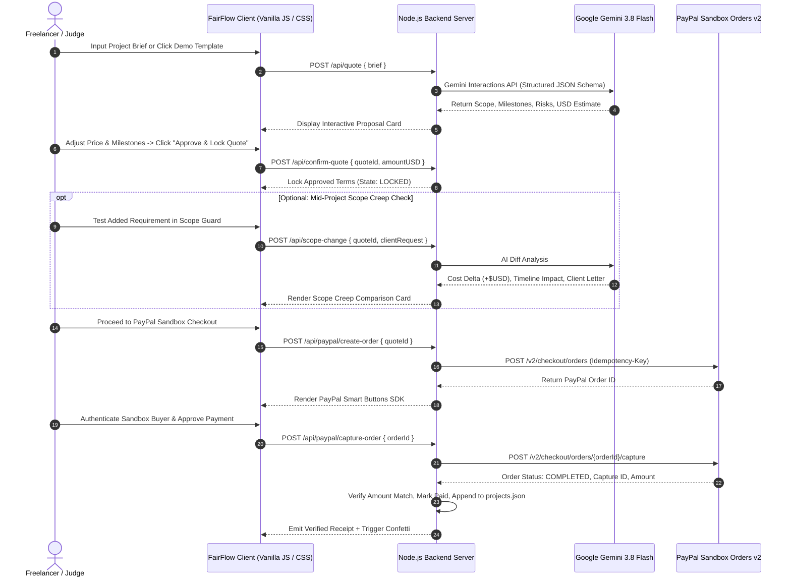

# FairFlow AI — AI-Powered Freelancer Trust & Payment OS

[](https://paypalaihackathon.devpost.com/)
[](https://nodejs.org/)
[](https://aistudio.google.com/)
[](https://developer.paypal.com/docs/api/orders/v2/)
[](LICENSE)
[](#architecture)

> **"From Project Agreement to Secure Payments, Powered by AI."**  
> FairFlow AI bridges the critical trust gap between freelancers and clients. By combining Google Gemini's cognitive analysis with PayPal's global payments infrastructure, FairFlow turns conversational project briefs into structured agreements, guards against scope creep, and executes secure milestone payments.

---

## Table of Contents

1. [The Problem & The Solution](#the-problem--the-solution)
2. [Key Innovations & Features](#key-innovations--features)
3. [Architecture & System Flow](#architecture--system-flow)
4. [Live Demo Walkthrough for Judges](#live-demo-walkthrough-for-judges)
5. [Quick Start & Setup Instructions](#quick-start--setup-instructions)
6. [PayPal Sandbox Testing Credentials](#paypal-sandbox-testing-credentials)
7. [API Reference](#api-reference)
8. [Security & Sandbox Safeguards](#security--sandbox-safeguards)
9. [Automated Tests & Verification](#automated-tests--verification)
10. [Hackathon Submission Information](#hackathon-submission-information)
11. [License](#license)

---

## The Problem & The Solution

| The Freelancer Nightmare | The FairFlow AI Solution |
| :--- | :--- |
| **Vague Scope & Disagreements:** Scope changes and unbilled revisions can lead to pricing disagreements and lost income. | **Gemini Scoping Engine:** AI structures informal briefs into itemized deliverables, milestone timelines, assumptions, and proactive risk audits. |
| **Silent Scope Creep:** Clients add "just one small feature" mid-project, leading to unpaid labor and resentment. | **AI Scope-Change Detector:** Real-time diff analysis comparing new requests against baseline scope, computing exact financial impact (+$USD) and timeline shifts. |
| **Payment Friction & Insecurity:** Sending raw invoices with no milestone protection leaves both parties exposed. | **PayPal Sandbox Orders v2:** Server-side order creation and capture with sandbox checkout, server-side payment verification, and printable test receipts. |
| **Lack of Human Agency:** Fully automated AI pricing can hallucinate unrealistic budgets. | **Human-in-the-Loop Approval:** The freelancer retains absolute authority. AI advises; humans approve; PayPal Sandbox processes test payments. |

---

## Key Innovations & Features

### 1. Multi-Model Gemini 3.8 Scoping Engine
* Analyzes messy client messages or brief descriptions into structured scopes.
* Generates itemized deliverables, percentage-based milestone breakdowns (Deposit, Alpha, Final Review), risk watchouts, and clarification questions.
* **Resilient Cascade Architecture:** Automatically falls back across `gemini-3.8-flash` → `gemini-3.5-flash-lite` → `gemini-3.1-flash-lite` to help handle unavailable models.

### 2. 1-Click AI Prompt Enhancer
* Turns 5-word ideas (e.g. *"build an online coffee store"*) into comprehensive technical briefs specifying tech stack, authentication, database schema, payment gateways, and security requirements.

### 3. Human-in-the-Loop Financial Control
* Freelancers can manually tweak milestone percentages and hit **"Auto-Balance to 100%"** for mathematically sound payment schedules.
* Hard validation bounds ($1.00 – $10,000.00 USD) prevent accidental under- or over-charging.

### 4. AI Scope-Change Detector (Scope Creep Guard)
* Pinpoints differences between the signed scope and new mid-project requests.
* Estimates exact financial delta (e.g. *+$1,200 USD*) and delivery timeline expansion.
* Drafts a polite, professional client-facing adjustment letter ready to copy and send.

### 5. Bank-Grade PayPal Orders API v2 Integration
* Server-side order initialization (`POST /v2/checkout/orders`) with unique idempotency keys.
* Client-side PayPal Smart Buttons loaded dynamically with sandbox client configuration.
* Server-side capture verification (`POST /v2/checkout/orders/{id}/capture`): verifies `COMPLETED` order status, matching capture ID, exact dollar amounts, and prevents replay or double-capture attacks.

### 6. Apple-Inspired Fluid Interface
* Deep Midnight Navy aesthetic designed using modern fintech UX guidelines (`ui-ux-pro-max`) and Apple interaction standards (`apple-design`).
* Optical SF Pro typography, 40ms touch responsiveness (`touch-action: manipulation`), spring animations, high-contrast `:focus-visible` accessibility rings, and mobile bottom sheet drawers for testing modals.
* 100% clean inline Lucide SVGs — zero generic raw emojis.

### 7. Zero External NPM Dependencies
* Built entirely on Node.js 22+ native modules: `http`, `crypto`, and native `fetch`.
* Instant startup, zero vulnerability surface, and ultra-lightweight codebase footprint.

---

## Architecture & System Flow



---

## Live Demo Walkthrough for Judges

Judges can test the entire lifecycle in under **2 minutes** at `http://localhost:3000`:

```
┌────────────────────────────────────────────────────────────────────────┐
│                        3-STEP JUDGE DEMO FLOW                          │
│                                                                        │
│   [ Step 1: Create & Scope ]   ───►  [ Step 2: Guard Against Creep ]   │
│   • Click 1-Click Demo Chip          • Click "Add Multi-Vendor Payouts"│
│   • Watch Gemini AI Scoping          • See AI calculate +$USD delta    │
│   • Auto-Balance to 100%             • Review professional letter      │
│   • Click "Approve & Lock Quote"                                       │
│                                              │                         │
│                                              ▼                         │
│                                [ Step 3: PayPal Sandbox Checkout ]      │
│                                • Launch PayPal Sandbox Smart Button    │
│                                • Complete Sandbox payment              │
│                                • View server-verified receipt & history│
└────────────────────────────────────────────────────────────────────────┘
```

### Detailed Scenario Guide

1. **Dashboard & Analytics:**
   * Open `http://localhost:3000`.
   * Observe high-level metrics (Total Volume, Active Agreements, Paid Projects, Sandbox Capture History) and the live transaction feed.
2. **Generate AI Proposal:**
   * Click **"+ New Proposal"**.
   * Click any 1-Click Demo chip (e.g. **"🛍 E-Commerce Store"**) or enter your own idea and test the **"⚡ AI Enhance Brief"** button.
   * Click **"✦ Generate AI Proposal"**. Gemini 3.8 Flash returns a structured deliverable matrix, percentage milestone breakdown, and project risk audit.
3. **Interactive Human Approval:**
   * Adjust milestone percentages; click the **"⚡ Auto-Balance to 100%"** button to see spring-based math reconciliation.
   * Set your final price (e.g., `$2,750.00`) and click **"✓ Approve & Lock Quotation"**.
4. **AI Scope Creep Detection:**
   * In the **AI Scope Change Guard**, test a scope creep scenario by clicking **"➕ Add Multi-Vendor Payouts"**.
   * Click **"✦ Analyze Scope Change"**. Gemini flags the severe architecture expansion, computes an additional cost delta (e.g., `+$6,500.00`), and produces an assertive client response letter.
5. **PayPal Sandbox Checkout:**
   * Click **"💳 Continue to Checkout"**.
   * Review the approved quote and PayPal Sandbox badge.
   * Click the golden **PayPal** button to launch the Sandbox popup.
   * Log in with a Sandbox Personal Test Buyer account (or follow the guide in the **"🧪 Sandbox Helper"** modal).
   * Confirm checkout. The server verifies the transaction against the PayPal Orders v2 API, records the verified sandbox capture, displays a printable receipt with Capture ID, and updates the local project ledger.

---

## Quick Start & Setup Instructions

### Prerequisites
* **Node.js 22.16+** installed (`node -v`).
* A **PayPal Developer Account** ([developer.paypal.com](https://developer.paypal.com/)) with Sandbox credentials.
* A **Google Gemini API Key** ([aistudio.google.com/apikey](https://aistudio.google.com/apikey)).

### Step 1: Clone the Repository
```bash
git clone https://github.com/keerthiprakash18/fairflow-ai.git
cd fairflow-ai
```

### Step 2: Configure Environment Variables
Create your local `.env` file by copying `.env.example`:
```bash
# Windows PowerShell
Copy-Item .env.example .env

# macOS / Linux
cp .env.example .env
```

Open `.env` in any text editor and paste your credentials:
```env
PAYPAL_CLIENT_ID=your_sandbox_client_id_here
PAYPAL_CLIENT_SECRET=your_sandbox_client_secret_here
GEMINI_API_KEY=your_gemini_api_key_here
GEMINI_MODEL=gemini-3.8-flash
PORT=3000
```

> **Security Note:** Never commit `.env` or share your API keys. `.env` is strictly ignored by `.gitignore`.

### Step 3: Verify & Start the Server
```bash
# Run syntax checks
npm run check

# Run automated security and unit tests
npm test

# Start the FairFlow application
npm start
```

Open your browser and navigate to:  
👉 **`http://localhost:3000`**

*(If port 3000 is occupied, set `$env:PORT=3001` in PowerShell or `PORT=3001 npm start` on Mac/Linux).*

---

### Verify REAL Gemini and PayPal Sandbox connectivity

With private credentials stored only in your local `.env`, run:

```powershell
npm run verify:integrations
```

This command makes a **real, small Gemini generation request** and gets a **real PayPal Sandbox OAuth token**. It does not create or capture a payment and does not print credentials.

For real end-to-end PayPal verification, approve a test checkout using a **Sandbox Personal Buyer** account in the app and check that the capture ID and USD amount match the receipt. Offline CI tests are mocked and are not proof of live provider connectivity.

## PayPal Sandbox Testing Credentials

To test the payment checkout flow:

1. Visit [PayPal Developer Dashboard → Testing Tools → Sandbox Accounts](https://developer.paypal.com/dashboard/accounts).
2. Use an existing **Personal (Buyer)** account or create a new one.
3. Click the three dots next to the account → **View/Edit Account** to retrieve the system-generated email and password.
4. When checking out in FairFlow AI, log in using these sandbox credentials. No real currency is charged.
5. You can also click the **"🧪 Sandbox Helper"** button in the FairFlow navigation bar to access an in-app guide at any time.

---

## API Reference

All endpoints are built using Node's standard HTTP server and return JSON responses.

| Method | Endpoint | Description | Guardrails |
| :--- | :--- | :--- | :--- |
| `GET` | `/api/health` | Service health, model status, sandbox flag | Never exposes secrets |
| `GET` | `/api/config` | Returns public PayPal Sandbox Client ID | Masks private secret |
| `GET` | `/api/projects` | Reverse-chronological project history | Reads local private ledger |
| `POST` | `/api/quote` | Gemini AI project analysis & quotation draft | Min 10 char brief required |
| `POST` | `/api/enhance-brief`| Gemini AI brief expansion tool | Min 5 char prompt |
| `POST` | `/api/confirm-quote`| Human review & pricing authorization | Bounded: $1.00 – $10,000.00 |
| `POST` | `/api/scope-change` | Gemini AI scope creep delta analysis | Requires confirmed base quote |
| `POST` | `/api/paypal/create-order` | Server-side PayPal Orders v2 creation | Idempotency key per quote |
| `POST` | `/api/paypal/capture-order`| Server-side PayPal capture & validation | Matches currency, amount, status |

---

## Security & Sandbox Safeguards

FairFlow AI is engineered following defensive fintech principles:

* **Zero Secret Leakage:** Private keys (`PAYPAL_CLIENT_SECRET`, `GEMINI_API_KEY`) stay strictly on the server and are never sent to the client browser or committed to Git.
* **Zero Client Trust:** All order prices, currency codes (`USD`), and payment amounts are locked and verified on the server. The client cannot spoof payment amounts.
* **Server-Side Capture Verification:** After PayPal approval, the server calls `/v2/checkout/orders/{id}/capture` directly to confirm that:
  1. The PayPal order ID matches.
  2. Order status is `COMPLETED`.
  3. Captured amount strictly equals the locked quote amount.
  4. Currency code is `USD`.
* **Double-Capture & Replay Protection:** In-flight capture locks and state flags prevent duplicate payment captures or double-charging.
* **Sandbox Environment Isolation:** Hard-coded to PayPal's Sandbox API (`https://api-m.sandbox.paypal.com`). Live credentials cannot be inadvertently used.

---

## Automated Tests & Verification

FairFlow AI includes comprehensive test suites that run without external dependencies:

```bash
# 1. Syntax Check across server.js and public/app.js
npm run check

# 2. Automated Unit & Security Test Suite
npm test
```

### Test Coverage (`tests/server.test.js`)
* Health endpoint does not misreport placeholder keys as configured.
* Serves complete frontend assets without leaking environment secrets.
* Rejects malformed brief submissions and unconfirmed quote scope checks.
* Strictly validates financial bounds ($1.00 – $10,000.00 USD).
* Enforces duplicate capture prevention and state transitions.

---

## Hackathon Submission Information

* **Hackathon:** [PayPal AI Hackathon 2026 on Devpost](https://paypalaihackathon.devpost.com/)
* **Project Name:** FairFlow AI
* **Tagline:** *From Project Agreement to Secure Payments, Powered by AI.*
* **GitHub Repository:** [`keerthiprakash18/fairflow-ai`](https://github.com/keerthiprakash18/fairflow-ai) (Public, MIT Licensed)
* **Devpost Video Pitch Guide:** Available in workspace artifact [`DEVPOST_SUBMISSION_PACKAGE.md`](file:///C:/Users/micha/.gemini/antigravity/brain/1008a506-d26d-43f8-833b-330edeb6cf83/DEVPOST_SUBMISSION_PACKAGE.md)
* **Technical Audit Report:** Available in workspace artifact [`HACKATHON_READINESS_AUDIT.md`](file:///C:/Users/micha/.gemini/antigravity/brain/1008a506-d26d-43f8-833b-330edeb6cf83/HACKATHON_READINESS_AUDIT.md)

---

## License

This project is open-source and licensed under the **[MIT License](LICENSE)** — see the LICENSE file for details.


### Verification and public-hosting limitations
Automated tests are not live Gemini/PayPal API verification. Health only shows credential configuration, never live provider connectivity. Verify Gemini requests and PayPal Sandbox buyer approval/capture manually with private credentials before submitting.
This app currently has **no user authentication** and `/api/projects` can expose project history. It is a local hackathon prototype, **not a public multi-user finance service**. Do not enter private client data or expose the service directly to the Internet without adding authentication and secured storage.


### November 2026 implementation refinements

- The interactive **Scope Lab** stays a clearly labelled sample. Choose a change, then click **Open ... in the workbench** to prefill the matching ecommerce baseline and carry the selected change into the real AI Scope Guard after quote approval. Live Gemini calls require a private API key.
- Demo scenario chip titles now match the briefs they actually insert. The PayPal Sandbox checkout is a **single full-quote capture**; milestone percentages are a planning breakdown, **not** separate scheduled payments or escrow.
- By default the prototype listens on `127.0.0.1` only. To run on another host, configure `HOST` deliberately; do **not** expose `/api/projects` publicly without authentication and secured storage.
- `npm run verify:integrations` performs optional real Gemini generation and PayPal Sandbox **OAuth-only** checks using local `.env`, without creating or capturing any payment. A successful result is still **not** a successful buyer checkout test.
- Inspo MCP is configured in `.codex/config.toml` for compatible, trusted Codex workspaces. It is not automatically connected to each ChatGPT session.
